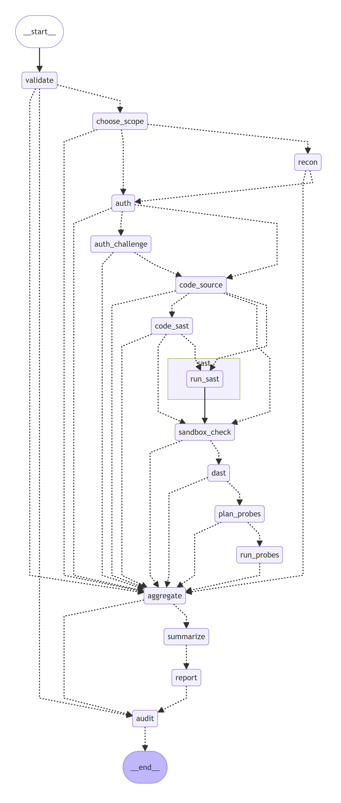

# pentest-agent (ScopeGuard)

Autonomous, guard-railed **web security scanner agent**. Orchestrated by LangGraph, optional Groq LLM,
exposed over a WebSocket. **No OWASP ZAP, no Java**: all scanning is pure Python and runs in a
Docker-free sandbox (a Dockerfile is provided only to package test -> drift check -> server).

> Authorization is mandatory. Only scan systems you own or are explicitly authorized to test.

## Architecture

New to ScopeGuard? Start with **[How a scan works, told as a story](docs/scan-story.png)**: every
agent as a character with one job, from your request to your report, in plain language.


A client signs in at `/auth/token` and sends the scan request over `/ws`. The request waits in the
server-wide queue (1 scan runs at a time, up to 50 wait; see [API management](#api-management-queues)),
then the server runs the LangGraph pipeline `validate → recon → auth → sast → sandbox_check → dast → plan_probes → run_probes → aggregate → summarize → report`
and streams progress back. `sast` runs only when the sandbox check is off (`SANDBOX_CHECK_ENABLED=false`):
otherwise `sandbox_check` applies the same JavaScript rules inside its Docker container
(`scopeguard-<session_id>`, removed after the run). Orange lines mark the only traffic to the target website (in scope only).
Only `plan_probes` and `summarize` call the LLM, and both have offline fallbacks. Reports and
SQLite checkpoints are written under `data/`. The same scan engine (`src/scopeguard/`) also runs
standalone through `python -m scopeguard.cli`.

### Agent graph



Drawn by LangGraph itself (`get_graph(xray=True).draw_mermaid()`). Solid edges are fixed, dashed
edges are `Command(goto=...)` routes declared in each node's return annotation, and the `sast` box
is the SAST sub-agent running as a subgraph. The LLM steps (`plan_probes`, `summarize`) are their own
nodes, so their results are checkpointed and a resumed run doesn't call the LLM again. Regenerate
after changing the graph with `uv run python scripts/draw_graph.py` (writes
[docs/agent-graph.mmd](docs/agent-graph.mmd) and the PNG; rendered locally, nothing is sent to a
diagram service).

## Quick start (no setup beyond Python 3.12)

```bash
# 1. Self-contained simulation. Needs NOTHING installed (stdlib only):
cd src && python -m scopeguard.cli --simulate
#    starts a vulnerable loopback target, scans it inside the sandbox, writes
#    data/reports/simulated-*/report.{md,json,html,docx}, runs a self-test (exit 0 = pass)

# 2. Scan your own app (sandboxed). The app must be running: an unreachable target exits 4.
python -m scopeguard.cli --url http://localhost:3000 --profile standard --i-have-authorization

# 3. View reports in the browser (loopback only):
python -m scopeguard.cli --simulate --serve      # scan, then serve -> http://127.0.0.1:8000/
python -m scopeguard.cli --serve --port 8000     # browse existing reports
```

On Windows without `python` on PATH, use the uv environment: `uv run python -m scopeguard.cli ...`
or `.venv\Scripts\python.exe -m scopeguard.cli ...`.

### Browser console (one command)

```bash
uv run pentest-agent          # server + console + built-in vulnerable target, opens your browser
uv run scopeguard-demo        # same, but always loopback-only and on a free port if 8765 is taken
```

The console is served by the agent server itself at `http://127.0.0.1:8765/`: a live view of the
11-node pipeline, an event stream, a findings radar, severity mix and risk grade, the cited executive
summary (each `[Sn]` jumps to its finding), attack coverage, a findings explorer and all saved
reports with html/docx/md/json downloads. The built-in target (`127.0.0.1` only) is offered as a
one-click demo target. Flags: `--no-browser`, `--no-target`, `--host`, `--port`.

There is no login screen, and API authentication stays on:

- The server prints a **one-time sign-in link** (`/#demo=<code>`, single use, valid 10 minutes, only
  its SHA-256 is kept in memory). The page exchanges the code at `POST /ui/demo-login` for a normal
  RS256 token pair with the `AUTH_CLIENT_ROLES` roles, then removes it from the address bar.
- The browser keeps the pair in `sessionStorage` (per tab) and sends the access token in the
  `Authorization` header, or in the first WebSocket message. Tokens are never put in a URL. The
  token is renewed 5 minutes before expiry with the single-use refresh token. The page also adopts
  `X-New-Access-Token` and `token_refreshed` pushes and retries once after refreshing on a 401.
- Report links work through an HttpOnly, SameSite=Strict cookie set by `POST /api/report-cookie`.
- Every UI file is served from a fixed whitelist with a strict CSP: no inline code, no third-party
  loads, no framing. Scanned-site text is rendered as text only, never parsed as HTML.
- `/ws` rejects browser connections from another origin (close `4403`).

Reloading the page keeps the session. After a restart, open the new link the server prints.
Replace `src/pentest_agent/webui/favicon/favicon.png` to change the tab icon and the top-left logo
(served at `/ui/favicon.png` and `/favicon.ico`, read from disk on each request). In Docker the
server runs with `--no-browser --no-target`.

### Full LangGraph + WebSocket agent

```bash
uv sync
cp .env.example .env            # GROQ_API_KEY is optional; empty = deterministic offline mode
uv run python scripts/get_token.py       # creates keys/ if needed and prints a 60-min access token
uv run python scripts/simulate_full.py   # whole pipeline against the built-in target (auth on)
uv run pentest-agent                      # console at http://127.0.0.1:8765/ + ws://127.0.0.1:8765/ws?session_id=<id>
uv run python scripts/ws_client.py --simulate   # Postman-free client for the running server (see --help)
uv run pytest
uv run golden-check                       # golden-dataset drift check (see below)
```

Client message: `{"url": "...", "profile": "quick|standard|aggressive|auth_deep", "authorization_confirmed": true}`
(`{"resume": true}` with the same `session_id` resumes from the SQLite checkpoint.)

Input is checked strictly. Anything outside these rules is rejected with
`{"type": "error", "code": 422, "message": "Invalid input", "detail": [...]}` and close code `4422`;
`detail` names each bad field but never echoes the submitted values:

| Key | Accepted |
| --- | --- |
| `session_id` (query) | 1-128 letters, digits, `.`, `_`, `-`, starting with a letter or digit (it names the report folder); otherwise error `400`, close `4400` |
| `url` | `http(s)://` URL |
| `profile` | `quick`, `standard`, `aggressive`, `auth_deep` |
| `authorization_confirmed` | JSON `true` only (`"true"`, `1` or `"yes"` are rejected) |
| `additional_allowed_domains` | up to 20 host names, optionally `:port`; no scheme, path or wildcard |
| `notes` / `jwt` / `source_path` | strings up to 2000 / 8000 / 1000 characters |
| `auth` | `login_url`, `username`, `password`, `username_field`, `password_field`, `extra_form_fields` (max 20) |
| `force_refresh` | `true` or `false` |
| `resume` | exactly `{"resume": true}`, nothing else in the message |
| `access_token` / `authorization` | the API token; removed before the request is processed |

Any other key is rejected. `POST /auth/token` and `/auth/refresh` reject unknown keys too (HTTP `422`).
The final `complete` message includes absolute report URLs: `report_url` (HTML view, e.g. `http://127.0.0.1:8765/reports/<session_id>/`) and `report_md_url`, `report_json_url`, `report_docx_url` (downloads). Server file paths are never sent. Warnings and errors are also written to `LOG_FILE` (default `data/logs/pentest-agent.log`).

While a scan runs, the server also sends `status` messages, for example when the LLM is
rate limited (`"event": "llm_rate_limit_wait"`, `"wait_seconds"`). One LLM call waits at most
`LLM_RATE_LIMIT_MAX_WAIT_SECONDS` (default 120) before that step uses its offline fallback.

### WebSocket client (instead of Postman)

`scripts/ws_client.py` runs the same WebSocket flow from the terminal against a running server.
Start the server first (`uv run pentest-agent`), then run the client in a second terminal from the repo root:

```bash
# Self-test against the built-in vulnerable target (prints SIMULATION PASSED/FAILED)
uv run python scripts/ws_client.py --simulate

# Scan your own site (only targets you own or are authorized to test)
uv run python scripts/ws_client.py https://your-app.example --profile standard --i-have-authorization

# Same, with your own access token (e.g. from scripts/get_token.py)
uv run python scripts/ws_client.py https://your-app.example --i-have-authorization --token "eyJhbGciOi..."

# Send a Postman-style JSON body as-is (an access_token inside it is used; nothing else signs in)
uv run python scripts/ws_client.py --payload keys/body.json

# Resume an interrupted run with the session id it printed
uv run python scripts/ws_client.py --session-id ws-1795422976 --resume
```

Example `--payload` body (keep it out of git: it holds a live token; `keys/` is gitignored):

```json
{
  "access_token": "<token>",
  "url": "https://your-app.example/",
  "profile": "standard",
  "authorization_confirmed": true,
  "force_refresh": true
}
```

The client checks `GET /healthz`, gets a token, connects to `/ws?session_id=<id>`, prints every
`status` / `phase_update` / `error` message as it arrives, adopts `token_refreshed` tokens,
and prints the report URLs at the end.

| Option | Meaning |
| --- | --- |
| `url` | target URL (needs `--i-have-authorization`; not used with `--simulate`, `--resume`, `--payload`) |
| `--profile` | `quick`, `standard` (default), `aggressive`, `auth_deep` |
| `--simulate` | scan the built-in vulnerable target and check the expected findings |
| `--payload FILE` | JSON file sent as the request body (overrides the scan options) |
| `--session-id ID` / `--resume` | choose the session id / resume that session from its checkpoint |
| `--force-refresh` | ignore a cached result for the same request |
| `--allow-domain DOMAIN` | extra in-scope domain (repeatable) |
| `--notes TEXT` | free-text notes stored with the scan |
| `--token TOKEN` | access token to use as-is |
| `--token-in message\|header\|query` | send the token in the first message (default), `Authorization` header or `?access_token=` |
| `--no-auth` | send no token (server with `AUTH_ENABLED=false`) |
| `--host` / `--port` | server address (default `127.0.0.1` / `WS_PORT`) |
| `--raw` | print every message as full JSON |
| `--save-md FILE` | write the markdown report to a file |

Without `--token` or a token in the payload, the client signs in at `POST /auth/token` with
`AUTH_CLIENT_ID` / `AUTH_CLIENT_SECRET` from `.env`, or signs a token locally with `keys/`.
Exit codes: `0` complete, `1` server error or rejected (e.g. `401` expired token),
`2` socket closed early (it prints the resume command), `3` server not reachable or no token.

### Report viewer

| Where | URL |
| --- | --- |
| WebSocket server | `http://127.0.0.1:8765/reports/` (index), `/reports/<session_id>/` (HTML), `/reports/<id>/report.{md,json,docx}` |
| CLI `--serve` | `http://127.0.0.1:<port>/` (index), `/<report-folder>/` (HTML) |

Downloads are named after the session id (CLI: the report folder), e.g. `money-dynocde-001.docx`,
`.md`, `.json`; on disk they stay `report.*`.
Reports are rendered with every target-controlled value HTML-escaped and served with a strict
`Content-Security-Policy` (no scripts), so a hostile page cannot inject markup into the viewer.

## API authentication (JWT) and roles (RBAC)

Every call to the agent server needs an access token, except `GET /healthz`,
`POST /auth/token` and `POST /auth/refresh`. Tokens are RS256 JWTs signed with
the key pair in `keys/` (gitignored, along with `*.pem`; never commit it).

```bash
uv run python scripts/get_token.py        # no arguments: creates keys/ if missing, prints a token
uv run pentest-auth keys                  # (re)create the key pair (--force replaces it)
uv run pentest-auth secret                # random value for AUTH_CLIENT_SECRET
uv run pentest-auth token --roles scanner # mint a token locally
uv run pentest-auth add-client --id ci-bot --roles viewer   # extra client; secret printed once, stored hashed
uv run pentest-auth list-clients | remove-client --id ci-bot | verify <token>
```

**Getting a token over HTTP**

```http
POST /auth/token        {"client_id": "<AUTH_CLIENT_ID>", "client_secret": "<AUTH_CLIENT_SECRET>"}
-> {"access_token", "refresh_token", "token_type": "Bearer", "roles", "expires_in": 3600, "expires_at", "refresh_expires_in"}
POST /auth/refresh      {"refresh_token": "..."}   -> a new pair (each refresh token works once)
```

Send it as `Authorization: Bearer <access_token>` on every HTTP request.

On the WebSocket, most clients cannot set handshake headers, so put the token in
the first JSON message (it is removed before the scan request is processed and
never reaches the agents, cache or logs):

```json
{"access_token": "<token>", "url": "https://your-app.example", "profile": "standard", "authorization_confirmed": true}
```

(`"authorization": "Bearer <token>"` in the message, the `Authorization` header, or
`?access_token=` in the URL also work.) The server waits up to 15 s for that first
message. Browsers can open reports with `?access_token=<token>` (masked in all
logs); the first report request then sets an HttpOnly cookie so the links inside work.

**Lifetime and automatic refresh**

| Setting | Default | Meaning |
| --- | --- | --- |
| `JWT_ACCESS_TTL_MINUTES` | 60 | access token lifetime |
| `JWT_AUTO_REFRESH_BEFORE_MINUTES` | 10 | the server renews a token with less than this left |
| `JWT_REFRESH_TTL_MINUTES` | 1440 | max session length from sign-in; no renewal after that |

The server renews tokens by itself. An HTTP response carries the new token in
`X-New-Access-Token` (and `X-New-Access-Token-Expires-At`). A WebSocket session
gets `{"type": "token_refreshed", "access_token": ..., "expires_at": ...}` before
expiry, so scans longer than an hour keep running. When the session cap is
reached the socket closes with 4401; sign in again and resume with the same
`session_id`. `pentest_agent.auth_client.TokenManager` does all of this for
Python clients (`scripts/scan_client.py` uses it).

**Roles** (`AUTH_CLIENT_ROLES` for the `.env` client, `--roles` for others)

| Role | Permissions |
| --- | --- |
| `viewer` | read reports |
| `scanner` | viewer + run/resume own scans (`quick`, `standard`) + LLM-planned probes |
| `admin` | scanner + `aggressive`/`auth_deep`, authenticated target testing (`jwt`/`auth` in the request), any user's sessions |

The API checks roles first (HTTP 403, WebSocket close 4403). The agent graph
checks them again per node from the caller stored in its state: the validate
node blocks forbidden profiles/credentials, the auth/DAST/probe nodes drop
target credentials without `scan:authenticated`, and the probe node is skipped
(with a red flag) without `scan:probes`.

| Error | HTTP | WebSocket |
| --- | --- | --- |
| missing/invalid/expired token | 401 + `WWW-Authenticate` | `{"type":"error","code":401}`, close 4401 |
| role lacks permission | 403 | `{"type":"error","code":403}`, close 4403 |

`AUTH_ENABLED=false` turns all of this off (local testing only). In Docker,
mount the keys (`-v "$PWD/keys:/app/keys"`); without them the container creates
a new pair at start, and tokens from other keys will not work.

## Text from scanned sites

Hyperlinks are removed from all text read from scanned websites before it is
stored or shown to an LLM (`scopeguard/textsafe.py`): finding evidence (scanner
engine and the agent's `Finding` model) and page content wrapped for the LLM.
Anchors and markdown links keep only their text; URLs and `href`/`src`/`action`
values become `[link removed]`. A finding's `affected_url` and the validated
source links in reports are scan metadata and stay.

## Sandbox code & content check, discovery, and attack coverage

Between the JS SAST and the live DAST, the agent runs a **sandbox check** of backend
source code and the website content it fetched from the target:

* It runs `scopeguard.codecheck` in a **Docker container** with `--network none`, a
  read-only filesystem, dropped capabilities and a non-root user; the analyzer also
  installs an audit hook, so any attempt to reach the network, run a process, or
  write/read outside the inputs is **blocked and reported as a red flag**. If Docker
  or the image is missing it falls back to the in-process sandbox and flags that.
  Pull the image once: `python -m scopeguard.container --setup`.
* **Website content** is fetched by the agent from the **target only** (scope-checked,
  no redirects followed); links, redirects and `fetch()`/script `src` to other hosts
  are listed and flagged, never downloaded. Page text that tries to steer an AI agent
  (prompt injection / jailbreak) is detected and flagged.
* **Backend source** (optional `source_path` in the request, admin `scan:source` only;
  constrained to `CODECHECK_SOURCE_ROOTS`) is scanned read-only for injection, SSRF,
  hardcoded secrets (masked), unsafe deserialization, weak crypto, disabled TLS
  verification, `none`-alg JWTs, wildcard CORS and more.

**Discovery** (recon): `robots.txt`, `sitemap.xml`/`sitemap_index.xml`, `security.txt`,
`crossdomain.xml`, `clientaccesspolicy.xml`, `openid-configuration` and other
well-known files are fetched on every in-scope origin. In-scope paths they reveal
(including robots.txt Disallow entries and sitemap URLs) seed the crawl; other hosts
they name are flagged and never visited. Sensitive robots paths, wildcard cross-domain
policies and expired/missing security.txt become findings.

**Attack coverage** (DAST): the live scan now also tests CORS bypasses (null / prefix /
suffix origin, preflight), reflected / script-context / `javascript:`-URL XSS,
error- / boolean- / time-based SQL injection, time-based OS command injection,
server-side template injection, CRLF/header injection, host-header injection, open
redirect, path traversal, weak CSP, extra cross-origin headers, **API docs exposure**
(`/docs`, `/redoc`, swagger, openapi, graphql consoles — reported accessible or not),
and **backend/API endpoints** referenced by the frontend (in-scope ones are requested
and tested, others only listed). Every report ends with an **Attack coverage** table:
for each check, how many tests ran, how many findings, and short notes — so a check
that found nothing is still recorded as having run.

**File upload testing** (aggressive/auth_deep profile + admin `scan:upload`, settable
with `ENABLE_UPLOAD_TESTS`): upload forms are always reported (accepted types, declared
max size). When active, the scanner POSTs **benign, inert marker files** under disguised
and dangerous names (`.php`, `.phtml`, `.jsp`, `.svg`, double extensions like
`x.jpg.php`, case/null-byte tricks, a renamed `.exe`, and an oversized file) to detected
same-origin upload endpoints, then checks whether they were accepted, stored or executed.
The payloads contain no shells and no real executables — only a unique marker string an
executing server would echo back — so the control is tested without planting a webshell.
Confirmed execution is reported CRITICAL (CWE-434).

**Safety stop**: every agent node (and the sub-agents) may run at most
`AGENT_MAX_ITERATIONS` times per scan (default 5); past that the step is skipped with a
red flag and the run moves on, and a LangGraph `recursion_limit` backstops the whole run.

## Pipeline

validate/gate -> recon+crawl -> auth -> JS SAST -> native DAST -> custom probes -> aggregate -> report (md + html + docx)

## LLM prompts (`prompts/`, not in the repository)

The system prompts for every LLM step are plain-text files in a local `prompts/` folder at the repo
root. The folder is gitignored, so a fresh clone does not include it. Each step loads its prompt with
`pentest_agent/prompts.py` from `PROMPTS_DIR` (default `./prompts`, relative to the working directory):

| File | Used by |
| --- | --- |
| `run_summary.md` | rolling summary of the run once the message history grows long (`graph.maybe_summarize`) |
| `executive_summary.md` | executive summary in the report, citing `[Sn]` sources (`graph.generate_executive_summary`) |
| `probe_plan_system.md` | custom probe plan (`subagents/codegen_subagent.generate_probe_plan`) |
| `golden_judge.md` | LLM-as-judge in the golden-dataset drift check (`evals/golden.judge_messages`) |
| `content_injection_reminder.md` | reminder paired with untrusted page content (`guardrails.content_injection_system_reminder`); `{{start}}` and `{{end}}` are replaced with the untrusted-content markers |

If a file is missing or empty, its step uses the same deterministic fallback as when no `GROQ_API_KEY`
is set. The scanner still runs and still writes reports, but without LLM-written text:

* the executive summary is the deterministic, fully cited summary, and `fallback_reason` names the missing file;
* the probe plan is the built-in default plan;
* the golden check reports `NOT_EVALUATED` when the judge prompt is missing.

Notes:

* The tests don't read your `prompts/`. `tests/conftest.py` writes stand-in prompts to a temp folder
  and points `PROMPTS_DIR` at it. With `GOLDEN_LIVE=1`, tests use the real `./prompts`.
* `docker build` copies `prompts/` into the image, so the folder must exist in the build context. An
  empty folder is fine, but the image then runs without LLM text. A built image contains your prompts,
  so keep it private if they are.

## Source citations (anti-hallucination)

Every finding becomes a numbered source `S1..Sn` (most severe first), linked to its in-scope URL and its
MITRE CWE page. The LLM executive summary must cite claims as `[Sn]`; afterwards
`scopeguard/citations.py`:

* removes citations to ids that are not in the source dictionary, and URLs that are not a known source
  or the target (hallucinated links);
* replaces surviving `[Sn]` markers, by regex, with links built from the dictionary;
* falls back to a deterministic, fully cited summary when the LLM answer is empty or has no valid citation.

Reports end with a **Sources** section; finding headings carry their `[Sn]` anchor.

## What the native DAST does (all GET/HEAD/OPTIONS/TRACE, non-destructive)

Spider (same-scope only) • security headers • cookie flags • CORS origin reflection • directory listing •
verbose errors • exposed `.env`/`.git`/phpinfo (soft-404 aware) • reflected input (unencoded `< " '`) •
error-based SQLi signature • open redirect (never followed) • path traversal signature • risky HTTP methods
(TRACE) • password-over-HTTP • POST form without CSRF token • JS static rules (eval, innerHTML, secrets...).

`quick` = passive only. `standard` = + active checks. `aggressive`/`auth_deep` = more targets + payload variants.

## Custom probes (`tools/probe_runner.py`)

The LLM (or, without one, a built-in default plan) picks up to 16 checks from a fixed list. Hand-written
Python runs each check with GET or OPTIONS only, never follows redirects, and never runs generated code.

| Probe type | What it reports |
| --- | --- |
| `security_headers` | missing HSTS, CSP, X-Content-Type-Options, Referrer-Policy, clickjacking protection |
| `csp_weakness` | a CSP that allows `'unsafe-inline'` (without nonce/hash), `'unsafe-eval'`, wildcard script sources, or unrestricted `object-src` |
| `cors` | a reflected untrusted Origin, or wildcard origin with credentials |
| `cookie_flags` | cookies without Secure, HttpOnly or SameSite |
| `cache_control` | responses that set cookies or answer an authenticated request without `no-store`/`private` |
| `http_methods` | methods advertised by `OPTIONS` (informational) |
| `server_banner` | server or framework versions in `Server`, `X-Powered-By` and similar headers |
| `information_disclosure` | stack traces and verbose framework errors in the body |
| `directory_listing` | auto-generated file indexes (Apache, nginx, IIS, Tomcat, Python) |
| `mixed_content` | `http://` scripts, styles, frames (Medium) or images/media (Low) on an HTTPS page |
| `insecure_transport` | the page answers on plain HTTP without redirecting to HTTPS (Informational for local/private hosts) |
| `open_redirect` | a query parameter that redirects to an outside host, tested with the unresolvable `https://scopeguard.invalid/` |
| `reflected_marker` | a harmless marker echoed back from a query parameter (informational, not proof of XSS) |

`open_redirect` and `reflected_marker` need a parameter name seen during the crawl. The default plan runs
the baseline checks on `/`, then open-redirect checks on redirect-like parameters (`next`, `url`, `return`, ...),
directory-listing checks on up to two crawled directories, then reflection checks.

## Caching (saves LLM cost and repeat requests)

Identical work within `CACHE_TTL_SECONDS` (default 300, i.e. 5 minutes; `0` turns caching off) is reused
instead of repeated (`pentest_agent/ttl_cache.py`):

| What | Reused when |
| --- | --- |
| Whole scan (WebSocket) | same request: URL, profile, credentials, extra domains and notes (`session_id` aside). The reply arrives instantly with `"cached": true`, `cached_from_session` and `cache_age_seconds`, and points at the earlier report. Send `"force_refresh": true` to scan again. |
| Probe check | same probe type, URL, parameter and bearer token |
| Probe plan (LLM) | same model, prompt, target, scope, findings and crawled pages |
| Executive summary (LLM) | same model, prompt and findings; only grounded answers are cached |
| Run summary (LLM) | same model and transcript |

Keys are SHA-256 digests, so tokens and passwords that are part of a key are never stored. Random finding
ids are left out of keys so a repeat scan still matches. Errors and fallbacks are never cached. Caches live
in memory in one server process and are shared by all its sessions; a restart empties them. The golden
drift check always calls the model fresh and never uses the cache.

## HTTP 429 handling

* **Scanned link**: every client that talks to the target (engine `ScopedClient`, and the agent's httpx
  clients via `http_retry.RateLimitRetryTransport`) retries `429` (and `503` with `Retry-After`) up to 3
  times, honouring `Retry-After` (seconds or HTTP-date, capped at 30s) or backing off 1/2/4s, and slows
  down after being throttled. Throttling is reported as a **red flag**, so incomplete results are visible.
* **LLM (Groq)**: retries 429/5xx, waiting for Groq's `Retry-After` (capped at 60s) or jittered backoff.
* **Backend**: a per-client-IP limit returns `429 Too Many Requests` + `Retry-After` on HTTP routes
  (`/healthz` exempt). Configure with `HTTP_RATE_LIMIT_PER_MINUTE`. Concurrency is handled by the
  server-wide queues below.

## API management (queues)

The server runs **1 WebSocket scan** and **1 HTTP API call** at a time, across all clients.
Up to **50** more of each wait in a first-come, first-served queue. When a queue is full, the request
gets `429` with the message *"Too many requests … Please try again after some time."* and a
`Retry-After` (WebSocket: error message, then close code `4429`). `/healthz` is never queued.

A queued WebSocket client gets a `queued` message right away, whenever its place changes, and every
`QUEUE_UPDATE_SECONDS` (default 5) while it waits:

```json
{"type": "queued", "position": 3, "queue_length": 5, "active": 1, "max_active": 1, "max_queue": 50,
 "estimated_wait_seconds": 240,
 "message": "Server busy (1/1 scans running). You are #3 in the queue: your scan starts after 3 more scan(s) finish (about 240s)."}
```

`position` is also the number of running scans that must finish before this one starts.
`estimated_wait_seconds` comes from recent scan durations (`null` until one has finished). When the
scan starts, the client gets `{"type": "status", "event": "queue_admitted", "waited_seconds": ...}`
and the normal flow continues. Disconnecting while queued gives up the place.
`scripts/ws_client.py` prints these as `[queue]` lines.

HTTP calls wait silently (at most `HTTP_QUEUE_TIMEOUT_SECONDS`, default 60, then `429`). Every
response carries `X-Queue-Position` (place at arrival, `0` = no wait) and `X-Queue-Wait-Seconds`.
`GET /healthz` shows the current counts:
`"queues": {"websocket": {"active", "max_active", "waiting", "max_queue"}, "http": {...}}`.

| Setting | Default | Meaning |
| --- | --- | --- |
| `WS_MAX_ACTIVE` / `HTTP_MAX_ACTIVE` | 1 | run at once (server-wide); `0` disables the queue |
| `WS_MAX_QUEUE` / `HTTP_MAX_QUEUE` | 50 | waiting places; more get `429` |
| `QUEUE_UPDATE_SECONDS` | 5 | interval of `queued` updates to waiting WebSocket clients |
| `HTTP_QUEUE_TIMEOUT_SECONDS` | 60 | longest an HTTP call waits before `429` |

The queues are in-process (`pentest_agent/admission.py`): run a single uvicorn worker.

## LangSmith tracing

Set `LANGSMITH_TRACING=true` and `LANGSMITH_API_KEY` (legacy `LANGCHAIN_*` names also work). Each scan is one
run tree: graph nodes, tools, Groq calls, the sandboxed DAST scan, probe planning/running, JS SAST and the
citation-grounding step, tagged with session id, target host and profile. A dedicated client redacts JWTs,
passwords, cookies, Authorization headers and API keys from inputs, outputs and metadata before upload.
Step-by-step setup, what each run shows and troubleshooting: [docs/LANGSMITH.md](docs/LANGSMITH.md).

## Golden dataset and drift check

`golden/golden_dataset.json` holds the golden cases (sandboxed scans of the built-in target and fixed
findings fixtures, with recorded baselines and reference summaries). `uv run golden-check` runs the real
pipeline on each case and checks:

* **Auth (JWT + RBAC)**: with `AUTH_ENABLED=true` every run mints a fresh access token for the subject
  `golden-check` (roles from `AUTH_CLIENT_ROLES`; keys are created if missing), verifies it exactly like the
  API does, checks each case's profile against the roles, and renews the token if it nears expiry. The report
  shows subject, roles, key id and expiry (never the token). An auth or permission failure is `NOT_EVALUATED`
  (exit 2), not drift.
* **Data (deterministic)**: required/forbidden finding titles, title-set Jaccard, severity histogram (±tolerance),
  pages crawled, blocked links, and input fingerprints against the baseline.
* **Model (deterministic)**: the LLM answer is used (no fallback), no hallucinated `[Sn]` ids or invented URLs,
  minimum citations, required sources cited, forbidden phrases absent, length.
* **Model (LLM-as-judge)**: a pydantic `JudgeVerdict` (faithfulness, coverage, citation accuracy, clarity, overall,
  hallucinations) whose `overall` score must be **>= 7** (`thresholds.min_judge_score`). Set
  `GOLDEN_JUDGE_MODEL` to use a different judge model than the generator.

It prints one strict verdict and exits with its code:

| Verdict | Exit | Meaning |
| --- | --- | --- |
| `NO_DRIFT` | 0 | data and model checks passed |
| `DATA_DRIFT` | 10 | the model's input data changed (scanner output / fixtures differ from baseline) |
| `MODEL_DRIFT` | 20 | data is stable but the LLM output failed a check or scored below threshold |
| `DATA_AND_MODEL_DRIFT` | 30 | both (model failures on drifted cases are not attributed to the model) |
| `NOT_EVALUATED` | 2 | no `GROQ_API_KEY` / judge error: the model could not be assessed |

Results are written to `golden/results/golden-<timestamp>/golden_report.{json,md}` and
`golden/results/latest.json` (git-ignored). `--allow-no-llm` runs data checks only; after an intentional
scanner change, re-capture baselines with `uv run golden-check --record-baseline`.
`GOLDEN_LIVE=1 uv run pytest tests/test_golden_dataset.py` also runs the live judge inside pytest.

## Docker

```bash
docker build -t pentest-agent .
docker run --rm -p 8765:8765 --env-file .env \
  -v "$PWD/golden/results:/app/golden/results" pentest-agent
```

The container runs **pytest** (offline; keys masked), then the **golden-dataset drift check** (needs
`GROQ_API_KEY`), then starts the **server** on `0.0.0.0:8765`, stopping at the first failure with that
step's exit code. `-e GOLDEN_ARGS=--allow-no-llm` skips the model part. `.env` is never copied into the image.

## Docker-free sandbox (`src/scopeguard/sandbox.py`, `worker.py`)

Scans run in a child interpreter (`python -I`) with: scrubbed environment (no API keys), throwaway working dir,
a permanent **audit hook** blocking subprocess/exec/fork/listening sockets, writes outside the sandbox dir,
DNS for non-allow-listed names, and any connection except allow-listed IP:port; POSIX rlimits (CPU, memory,
file size, fds); hard wall-clock kill. Inside, `ScopedClient` re-checks scope on every request, never follows
redirects automatically, and enforces a request budget and size caps. `tests/test_scopeguard_sandbox.py`
proves the escapes are blocked. (Windows: rlimits unavailable; all other layers apply.)
This is strong process-level containment, not a VM/kernel boundary. Do not scan hostile targets with it on a
machine holding secrets you cannot afford to expose.

## Network policy: no metadata, no DNS rebinding (`src/scopeguard/netpolicy.py`)

Some addresses are never reached by a scan:

- link-local / cloud metadata (`169.254.0.0/16`, `fe80::/10`, `fd00:ec2::254`, `100.100.100.200`,
  `192.0.0.192`, `metadata.google.internal`, …);
- `0.0.0.0/8` and `::`, multicast, reserved and broadcast addresses;
- IPv6 forms that hide one of those (IPv4-mapped, NAT64, 6to4, Teredo) are unwrapped and refused too.

`BLOCK_PRIVATE_TARGETS=true` also refuses loopback and private ranges (`127/8`, `10/8`, `172.16/12`,
`192.168/16`, `100.64/10`, `fc00::/7`, `localhost`). It defaults to `false` so local dev apps and the demo
target can be scanned. The policy is enforced in four places:

| Layer | What happens |
| --- | --- |
| Browser console | An obviously blocked URL (e.g. `http://169.254.169.254/`, `http://0xA9FEA9FE/`) disables Launch with the reason. |
| Pre-scan guardrail | The target and every extra allowed host are resolved. If any address is blocked, the scan is refused (`validate → blocked`, shown as REFUSED); an unresolvable target is refused too. |
| Every agent-side connection (`http_retry.PinnedNetworkBackend`) | The host is resolved and every address checked, then the socket opens to exactly the checked IP (TLS still verifies the real host name). A DNS answer that changes mid-scan (DNS rebinding) is refused before any socket is opened. Environment proxies are ignored. |
| Sandbox worker | Blocked addresses never enter the egress allowlist and are never probed; a blocked target ends the scan with an error. |

`scopeguard.cli --url` applies the same check (exit code `5`) and reads `BLOCK_PRIVATE_TARGETS` from the
environment.

## Scans never download files (`src/scopeguard/contentpolicy.py`)

- **No file links are crawled.** Links to executables, installers, archives, disk images, office/PDF
  documents, media, fonts and wasm are never requested by the crawlers. Fixed security probes such as
  `/backup.zip` still send their single request but only use the status and headers.
- **Attachments and binaries are discarded unread.** This covers `Content-Disposition: attachment`, binary
  media types and unsupported compression (`br`, `zstd`): the connection is closed without reading the body.
  The response keeps its status and headers plus `x-scopeguard-body-dropped: <reason>`.
- **Unknown types are sniffed.** At most 64 KB is read; a body with NUL bytes or a file signature
  (MZ/ELF/ZIP/PDF/…) is discarded. Text bodies are capped at 2 MB in memory, and gzip/deflate is decoded
  with a hard output cap, so a compression bomb cannot expand.
- **Nothing from the target is saved as a file.** The one exception is the sandboxed code check, which stages
  the *text* of in-scope HTML pages and JavaScript under fixed names (`pages/0001.html`, `scripts/0001.js`)
  in a private temp folder. That folder is mounted read-only into a `--network none` container and deleted
  when the check ends. Reports quote short evidence snippets as text.
- **Refused downloads are reported.** The report's attack coverage lists them as "File downloads refused".

## Layout

`src/scopeguard/` stdlib-only engine, sandbox, citations, rate limiting, reports, simulated target, CLI.
`src/pentest_agent/` LangGraph agent, guardrails, schemas, tools, tracing, rate limits, websocket server,
`evals/golden.py`, `prompts.py`. `golden/golden_dataset.json`, `tests/`, `scripts/simulate_full.py`, `Dockerfile`.
`prompts/` (local only, gitignored) holds the LLM prompt texts; see [LLM prompts](#llm-prompts-prompts-not-in-the-repository).
